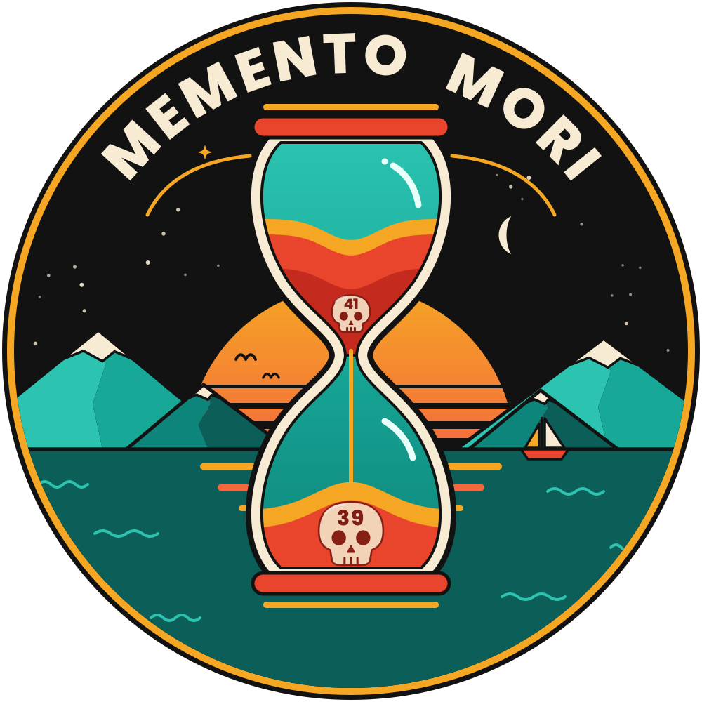

<p align="center">
  
</p>

# Memento Mori - Life in Weeks

A Flutter app that shows your life as a grid: one cell per week (or month, or year), filled for
time lived and empty for time remaining, based on your birth date and a configurable life
expectancy (default 80 years).

Licensed under the [GNU General Public License v3.0](LICENSE) (GPL-3.0). Bundled fonts and data
keep their own licenses (see [Third-party assets](#third-party-assets)).

## Features

- **Life tab** - life grid in weeks, months or years with zoom, cell details, a daily quote
  (same quote in every language) and your next upcoming birthday; alternative layouts (spiral,
  liquid progress, tree rings).
- **Lifespan estimate** - optional estimate based on the UN World Population Prospects 2024
  life tables, computed on the device (no internet needed); or set the life expectancy yourself.
- **Compass** - a gentle life to-do list: a weekly question, up to three things for "Now", a
  "Someday" list and what you have "Lived", plus a look back.
- **People** - friends and family with birthdays, groups, avatars and search/filter/sort;
  birthday reminders (local notifications, next two birthdays scheduled per person).
- **Together** - on a friend's page, both lives on one timeline and a rough count of the
  encounters left at your usual meeting frequency, with "Plan time together".
- **Weekly questions** - optional Sunday-evening reminder carrying that week's Compass question.
- **Calendar sync** - optional yearly all-day birthday events in a device calendar.
- **Backup** - JSON import/export including avatars (backup format 1.1; 1.0 files still import).
- **Onboarding** - birth date, lifespan estimate, an animated life-grid reveal and the reminder
  opt-in (plus a skippable support step in `foss` builds).
- **Themes** - Material 3 with Stoic (default) and Warm styles, light/dark/system, optional grid
  colour themes.
- **Languages** - English, German, French and Spanish (initial language follows the device
  locale).

## Platforms and native extensions

The app itself is Flutter on Android and iOS. Small native extensions show the same data outside
the app:

- **Android home-screen widget** - Jetpack Glance, small/medium/large (large = week grid).
- **iOS home-screen widget** - WidgetKit (iOS 17+), small/medium/large plus lock-screen
  circular/rectangular/inline.
- **Wear OS** (`android/wear`) - watch app, Tile and complication (ranged value / short text).
- **Apple Watch** (`ios/MementoWatch`, `ios/MementoWatchWidget`) - watch app and complications
  (watchOS 10+).

## Architecture

- Flutter for the app and all UI; native code only for the small platform extensions above.
- Native extensions never call into Flutter: Flutter publishes plain inputs (birth date, life
  expectancy, display mode, language, theme, ...) and each native side computes what it shows.
  The contract is `docs/widget-data-contract.md` (schema v1); watches receive the same keys via
  the Wearable Data Layer / WatchConnectivity.
- The life arithmetic exists once per language: Dart `lib/core/life_calculator.dart`, Kotlin
  `android/lifecore`, Swift `ios/LifeCore`. All three are checked against the shared fixtures in
  `test/fixtures/life_calculator_vectors.json`.

See `CLAUDE.md` for structure and implementation notes.

## Requirements

- Flutter 3.47.9 (Dart 3.13)
- Android: JDK 17, Android SDK 36 (minSdk 24; Wear OS minSdk 30, compileSdk 37)
- iOS: Xcode with the iOS and watchOS SDKs (plugins via Swift Package Manager, no CocoaPods);
  iOS 15+, widget iOS 17+, watch watchOS 10+

## Build, run, test

```bash
flutter pub get                 # also writes android/local.properties (flutter.sdk)
# Android needs --flavor play|foss (see "Release"); iOS has no flavors
flutter run --flavor foss
flutter run -d <ios-udid>
flutter build apk --debug --flavor play      # or --flavor foss
flutter analyze                 # must stay at 0 issues
flutter test

cd android && ./gradlew :lifecore:test :app:testPlayDebugUnitTest :app:testFossDebugUnitTest :wear:testDebugUnitTest
cd android && ./gradlew -q :app:dependencies --configuration fossReleaseRuntimeClasspath | grep -i gms   # must print nothing
cd android && ./gradlew :wear:assembleDebug     # build/wear/outputs/apk/debug/wear-debug.apk
cd ios/LifeCore && swift test                   # Swift cores, widget + watch snapshots (macOS)
cd ios && xcodebuild -project Runner.xcodeproj -scheme MementoWatch \
  -destination 'generic/platform=watchOS Simulator' build
flutter pub run flutter_launcher_icons:main     # regenerate launcher icons
```

`flutter build`/`flutter run` never build the Wear OS module; build it with Gradle as above.
CI (`.github/workflows/ci.yml`) runs the Flutter, Gradle and Swift checks on every push and pull
request.

## Release

```bash
flutter build apk --release --flavor foss                   # build/app/outputs/flutter-apk/app-foss-release.apk
flutter build apk --release --flavor foss --split-per-abi   # one APK per ABI (~22-26 MB each)
flutter build appbundle --release --flavor play             # build/app/outputs/bundle/playRelease/app-play-release.aab
flutter build ios --release
```

- Flavors (same application id): `play` (Google Play: Wear OS watch sync via Play services;
  asks for a rating instead of showing the Buy Me a Coffee link) and `foss` (F-Droid, direct
  APK and other stores: no Google Play Services at all, keeps the link). iOS builds also ask
  for a rating (App Store rules).
- **Android signing: TODO** - the release build is still signed with the debug keys
  (`android/app/build.gradle`); add a release keystore before publishing.
- **iOS**: open `ios/Runner.xcworkspace` and set a development team for Runner, MementoWidget,
  MementoWatch and MementoWatchWidget; the App Group
  `group.lifetree.coach.memento_mori_life_in_weeks` must be registered for that team.

## Third-party assets

These files are not covered by the GPL and keep their own licenses:

- Fonts in `assets/fonts/` (Fraunces, Inter, Nunito) - SIL Open Font License 1.1, see
  `assets/fonts/licenses/`.
- `assets/lifespan/wpp2024_lt.bin` - derived from the UN World Population Prospects 2024 life
  tables (CC BY 3.0 IGO; modified, no endorsement by the UN implied), see
  `assets/lifespan/licenses/wpp.txt`.
- `assets/lifespan/countries.json` - country names from Unicode CLDR 48 (Unicode License v3),
  see `assets/lifespan/licenses/unicode.txt`.

How these assets are built: `tool/README.md`.

## Feedback & ideas

Questions, ideas and bug reports are welcome in
[GitHub Discussions](https://github.com/LifeTreeCoach/memento-mori/discussions).

## Support the project

If you like the app, you can support it via the Sponsor button on GitHub or
[Buy me a coffee](https://buymeacoffee.com/monkeywave). Help without money counts just as much:
rate the app in your store, help with translations, or report bugs.
